# MRIDUL RAJGARIA

**Software Engineer | Backend Systems | Applied AI | Data-Driven Products**  
B.Tech Computer Science and Engineering, Vellore Institute of Technology • Class of 2027  

[GitHub](https://github.com/mridulrajgaria) • [LinkedIn](https://www.linkedin.com/in/mridul-rajgaria-112257288/) • [Email](mailto:iammridul222@gmail.com) • [Interactive Portfolio](https://mridulrajgaria.github.io/portfolio-2026/)

---

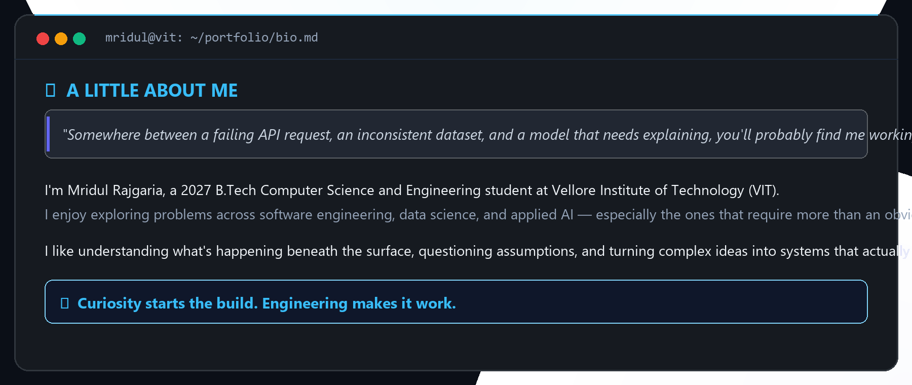

---

## 🏆 Competitive Achievements & Recognition

| Award / Recognition | Event / Issuer | Highlights & Core Project |
| :--- | :--- | :--- |
| 🥉 **3rd Place Winner** | **Intain Campus FinTech Challenge 2026** | Awarded for building **Loan Data Verification Copilot**—an underwriting attestation platform featuring automated multi-source normalization, Claude AI advisory reasoning, and SHA-256 cryptographic tamper verification. |
| 🏅 **Top 15 Finalist** | **ZS Campus Beats 2026** | Evaluated among **2,600+ national competing teams** across advanced problem-solving, algorithmic thinking, and product architecture rounds. |
| 📄 **Published Research** | **Journal of The Institution of Engineers (India): Series B (Springer)** | Author of *"Cutting-Edge Image Recognition Leveraging Deep Learning and Machine Learning for Enhanced Accuracy"* (Sept 2024), analyzing transfer-learning optimization across deep convolutional architectures. |

---

## 🏗️ SECTION A — Software Engineering & Backend Systems

Architecture-first applications focusing on high concurrency, distributed state, API design, and enterprise data integrity.

### 1. RouteFlow — Autonomous Delivery & Dispatch Platform
*An automated last-mile dispatch and telemetry engine managing the end-to-end delivery lifecycle from volumetric quote computation to agent routing.*
- **System Architecture:** Implements autonomous dispatch matching field couriers via Haversine GPS proximity and real-time workload weighting. Enforces parcel lifecycle transitions through an immutable audit-logged Finite State Machine (FSM) backed by PostgreSQL and Prisma ORM, supported by a pluggable notification system (Nodemailer and Twilio).
- **Quality & Verification:** Validated with 216 comprehensive test suites executed via Vitest.
- **Tech Stack:** `TypeScript` `Node.js` `Express` `PostgreSQL` `Prisma` `React` `Tailwind CSS` `Vitest` `Render` `Vercel`
- **Links:** [GitHub Repository](https://github.com/mridulrajgaria/routeflow-unthinkable) • [Live Production App](https://routeflow-unthinkable.vercel.app)

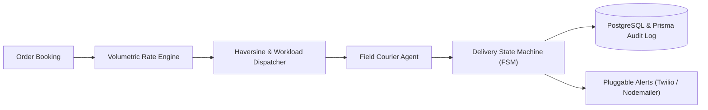

<b>🔍 System Blueprint: Autonomous Dispatch & FSM Lifecycle</b>

 

1. **Spatial Proximity & Workload Scoring:** Evaluates candidate field agents within a bounding radius. Computes Haversine coordinates and applies dynamic load balancing:
   $$\text{Score} = \text{Distance (km)} + (\text{Active Orders} \times 2.5)$$
2. **Finite State Machine Enforcement:** Every parcel progresses through strict deterministic states: `ORDER_CREATED` $\rightarrow$ `DISPATCHED` $\rightarrow$ `IN_TRANSIT` $\rightarrow$ `OUT_FOR_DELIVERY` $\rightarrow$ `DELIVERED`. Illegal transitions trigger rollback exceptions.
3. **Immutable Audit Provenance:** All transitions and location telemetry updates execute inside atomic Prisma database transactions, committing timestamped actor snapshots to PostgreSQL.

 

### 2. Token-Based API Gateway
*A high-concurrency middleware reverse proxy engineered to shield GenAI backend infrastructure from token exhaustion and concurrent race conditions.*
- **System Architecture:** Replaces standard Requests-Per-Second (RPS) throttling with dynamic token-consumption rate limiting. Executes an atomic Token-Bucket algorithm natively in Redis via custom Lua scripts to guarantee $O(1)$ synchronization under heavy concurrency spikes, offloading token usage reconciliation asynchronously to MongoDB to preserve $<15\text{ms}$ proxy latency.
- **Tech Stack:** `Node.js` `Express` `Redis` `Lua Scripting` `MongoDB` `Docker` `Docker Compose`
- **Links:** [GitHub Repository](https://github.com/mridulrajgaria/LLM-API-Gateway-with-Token-Based-Rate-Limiting)

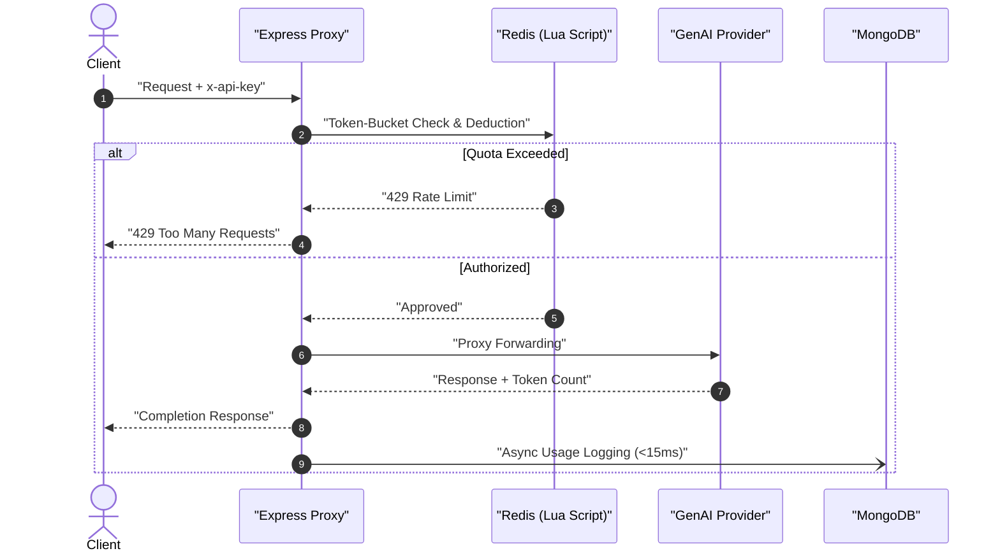

 

### 3. SmartEMS — Enterprise Decoupled Employee Management Platform
*A production-grade decoupled enterprise workforce management platform pairing a stateless Java backend with a modular React client.*
- **System Architecture:** Built on Spring Boot 3 adhering to strict layered architecture (Controller $\rightarrow$ Service $\rightarrow$ Repository). Enforces 100% stateless JWT authentication and role-based access control (`ROLE_ADMIN` and `ROLE_EMPLOYEE`) with BCrypt password hashing, enterprise CORS filtering, and documented OpenAPI/Swagger REST contracts.
- **Tech Stack:** `Java 17` `Spring Boot 3` `Spring Data JPA` `MySQL` `H2 Database` `React 18` `Vite` `JWT` `Docker`
- **Links:** [GitHub Repository](https://github.com/mridulrajgaria/employee-management-system) • [Live Application](https://ultimatesmartems.netlify.app)

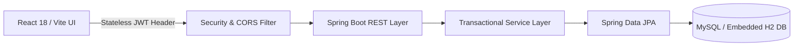

 

### 4. BDA CRM — Manufacturing Operations Platform
*A full-stack MERN CRM purpose-engineered for industrial Business Development Associate teams managing multi-tier customer relationships.*
- **System Architecture:** Role-governed operational dashboard providing drag-and-drop Kanban lead pipeline progression, structured client profile management, activity timeline tracking, and dynamic sales team performance aggregation.
- **Tech Stack:** `MongoDB` `Express.js` `React` `Node.js` `Tailwind CSS` `Recharts` `JWT Auth`
- **Links:** [GitHub Repository](https://github.com/mridulrajgaria/bda-crm-module) • [Live Application](https://bda-crm-module.vercel.app)

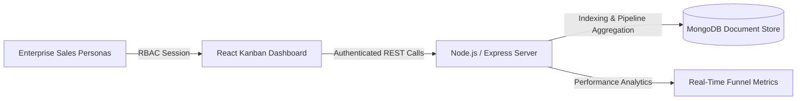

---

## 📈 SECTION B — Data Science & Analytics

Analytical systems evaluating real-world and synthetic datasets using statistical modeling, dimensional data warehousing, and executive business intelligence.

### 1. E-Commerce Customer Equity & Retention Intelligence Engine
*An end-to-end retail intelligence platform combining dimensional SQL warehousing, cohort retention modeling, and predictive churn forecasting.*
- **Analytical Methodology:** Built on a Kimball star-schema data warehouse across dual SQL engines (PostgreSQL and T-SQL). Implements automated RFM customer behavioral segmentation, longitudinal cohort retention matrices, and predictive churn modeling using XGBoost evaluated against synthetic multi-channel transaction datasets, surfaced via interactive Power BI executive cockpits.
- **Dataset Context:** Evaluated on synthetically generated multi-channel retail transaction datasets.
- **Tech Stack:** `Python` `PostgreSQL` `T-SQL` `Pandas` `XGBoost` `SHAP` `Power BI` `Star Schema`
- **Links:** [GitHub Repository](https://github.com/mridulrajgaria/E-commerce-Sales-and-Customer-Analytics)

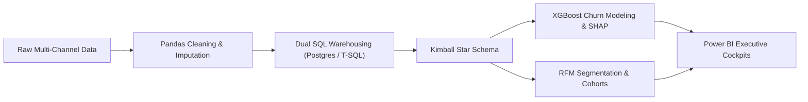

<b>🔍 System Blueprint: Star-Schema Dimensional Modeling & Churn Evaluation</b>

 

1. **Dimensional Data Modeling:** Deconstructed relational logs into an enterprise star schema featuring a central `fact_orders` table bound to conformed dimensions (`dim_customers`, `dim_products`, `dim_dates`, and `dim_channels`) to accelerate complex analytical joins across PostgreSQL and T-SQL.
2. **Behavioral RFM Segmentation:** Quantified customer equity by dynamically ranking Recency, Frequency, and Monetary metrics into percentiles, isolating high-value champions from at-risk accounts.
3. **Predictive Churn Engine:** Trained XGBoost classification models on historical purchase intervals. Applied SHAP (SHapley Additive exPlanations) values to isolate the primary feature drivers triggering customer churn across transaction cycles.

 

### 2. Borrower Default Risk Analytics on Home Credit Data
*A comprehensive diagnostic credit risk analytics pipeline evaluating default probability drivers across 307,511 real-world loan applications.*
- **Analytical Methodology:** Combines rigorous Pandas data cleaning, missing-value imputation, and class imbalance handling with complex SQLite analytical queries utilizing Common Table Expressions (CTEs) and window functions. Evaluates credit risk distributions across demographic cohorts and income brackets to recommend actionable underwriting thresholds via Power BI.
- **Dataset Context:** Real-world benchmark credit portfolio (307,511 records from Home Credit).
- **Tech Stack:** `Python` `Pandas` `SQL (SQLite CTEs & Window Functions)` `Power BI` `Exploratory Data Analysis`
- **Links:** [GitHub Repository](https://github.com/mridulrajgaria/Borrower-Default-Risk-Analytics-on-Home-Credit-Data)

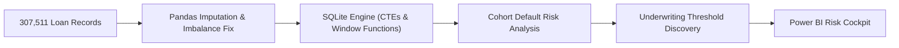

 

### 3. Corona Sentiment Analysis & NLP Research Archive
*An empirical NLP study investigating public sentiment trajectories and emotional shifts throughout the COVID-19 pandemic.*
- **Analytical Methodology:** Analyzes large longitudinal text corpora using classical lexicon-based sentiment scoring, multi-class emotion classification models, and fine-tuned BERT transformer embeddings across distinct outbreak waves, accompanied by an interactive exhibition web interface.
- **Tech Stack:** `Python` `BERT` `Transformers` `NLTK` `Scikit-learn` `Jupyter Notebooks` `HTML/CSS`
- **Links:** [GitHub Repository](https://github.com/mridulrajgaria/Sentimental_Analysis_Corona)

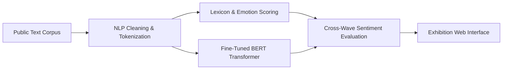

---

## 🤖 SECTION C — AI, Machine Learning & Intelligent Applications

Systems integrating machine learning, document intelligence, and generative models with strict grounding and operational explainability.

### 1. Honeywell QCS — Grade Change Intelligence Layer
*An AI-driven Human-Machine Interface (HMI) simulation optimizing industrial paper machine transitions to minimize raw material waste.*
- **Machine Learning Architecture:** Models First-Order Plus Dead Time (FOPDT) physical simulation dynamics for grade transitions. Trains XGBoost classifiers for transition failure risk and regression models for stabilization duration forecasting, integrated with SHAP feature attribution to explain deviation drivers and an SQLite audit trail for logging operator accept/reject actions under ISA-101 industrial HMI standards.
- **Industrial Context:** Simulation environment utilizing FOPDT physics modeling; not a live factory floor deployment.
- **Tech Stack:** `Python` `FastAPI` `XGBoost` `SHAP` `Scikit-learn` `React` `Recharts` `SQLite`
- **Links:** [GitHub Repository](https://github.com/mridulrajgaria/honeywell-qcs-demo)

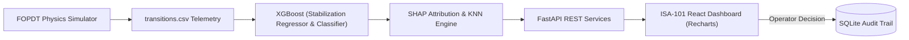

<b>🔍 System Blueprint: Industrial FOPDT Simulation & Closed-Loop Attribution</b>

 

1. **FOPDT Physical Modeling:** Synthesizes realistic non-linear paper machine dynamics governed by First-Order Plus Dead Time differential equations, generating stock flow, caliper, and basis-weight transitions.
2. **Dual-Model Inference:** Runs an XGBoost classifier to compute real-time probability of deviation failure alongside an XGBoost regressor forecasting the time required to reach target basis-weight stabilization.
3. **Closed-Loop Operator Feedback:** Operators evaluate AI recommendations (speed, stock flow trims) on an ISA-101 compliant interface. Operator accept/reject decisions are permanently recorded into an SQLite audit log to support continuous model re-training.

 

### 2. Fact Knowledge Layer — Document Intelligence Engine
*An evidence-grounded document intelligence platform extracting structured claims and reconciling cross-document contradictions from unstructured PDFs.*
- **AI Architecture:** Ingests complex multi-page PDF documents, extracts atomic claims directly anchored to verbatim source text coordinates, computes semantic embeddings using Google Gemini, and builds a cross-document knowledge graph to detect corroborations, contextual conflicts, and factual reconciliations.
- **Tech Stack:** `Python 3.12` `Google Gemini API` `Vector Embeddings` `Knowledge Graphs` `PyMuPDF` `NLP`
- **Links:** [GitHub Repository](https://github.com/mridulrajgaria/SuperJoin-Knowledge-Layer)

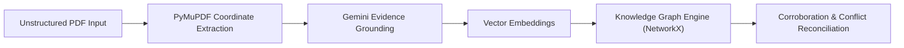

 

### 3. Dictation Postcards — LLM-Powered Generative Experience
*A voice-first creative web application transforming spoken daily reflections into tactile, algorithmic hand-sketched digital postcards.*
- **AI Architecture:** Captures voice audio via the Web Speech API and routes transcription to LLM structured prompting pipelines (Google Gemini / OpenAI). Extracts psychological mood attributes, custom four-color palettes, and poetic micro-copy, dynamically rendered into hand-drawn canvas art using rough.js alongside 3D card flips and persistent corkboard galleries.
- **Tech Stack:** `TypeScript` `Next.js` `Web Speech API` `Google Gemini API` `Rough.js` `Tailwind CSS`
- **Links:** [GitHub Repository](https://github.com/mridulrajgaria/dictation-postcards)

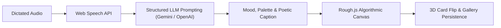

---

## ⚡ SECTION D — Hackathons & Competitive Engineering

High-pressure competitive prototypes developed for national and enterprise hackathons, focusing on novel fintech, risk intelligence, and cryptographic workflows.

### 1. Loan Data Verification Copilot — Intain FinTech Challenge (3rd Place 🥉)
*A full-stack loan tape validation platform with automated multi-source reconciliation, advisory Claude AI diagnostics, and SHA-256 cryptographic attestation.*
- **Engineering Highlights:** Ingests raw mortgage tapes while maintaining complete byte-level data lineage. Executes a configurable 15-rule deterministic validation engine (evaluating DPD matrices, usury limits, and duplicate triplets), integrates an advisory Anthropic Claude AI layer for plain-English failure explanation, and commits verified loans into an immutable ledger sealed with canonical SHA-256 record hashes with an integrated tamper-detection simulator.
- **Tech Stack:** `Node.js` `Express` `React` `Tailwind CSS` `Anthropic Claude API` `SQLite` `SHA-256 Attestation` `Zod`
- **Links:** [GitHub Repository](https://github.com/mridulrajgaria/loan-data-verification-copilot) • [Live Production App](https://loan-data-verification-copilot-alpha.vercel.app/)

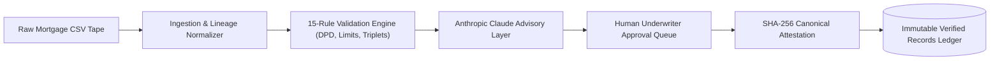

<b>🔍 System Blueprint: Deterministic Validation, AI Advisory & SHA-256 Attestation</b>

 

1. **Byte-Level Lineage:** Preserves raw input rows verbatim in `RawLoanRecord` while mapping into a strongly typed `NormalizedLoan` schema, ensuring absolute traceability back to source files.
2. **Deterministic 15-Rule Engine:** Evaluates loan records against critical business bounds (interest rate usury thresholds, Days Past Due servicing matrices, and borrower duplication checks). Fails decisively on logic errors prior to human review.
3. **Advisory AI Isolation:** Employs Anthropic Claude to generate human-readable failure explanations and reconciliation proposals, strictly isolated as non-binding suggestions (`accepted_by_reviewer = null` until signed off).
4. **Cryptographic Attestation:** Once verified by an underwriter, record fields are normalized via canonical JSON sorting (`canonicalStringify`) and hashed into a tamper-evident SHA-256 fingerprint (`recordHash`), verifiable via an integrated forensic verification script.

 

### 2. AI/NLP Financial Risk Engine — S&P Global × CRISIL Campus Hackathon 2026
*A market intelligence pipeline translating raw financial news streams into quantitative portfolio vulnerability signals.*
- **Engineering Highlights:** Ingests unstructured financial news and corporate disclosures, computes entity-level sentiment and macro vulnerability indicators using financial NLP transformers, and translates textual signals into dynamic portfolio risk weight adjustments.
- **Tech Stack:** `Python` `FinBERT` `Transformers` `Pandas` `FastAPI` `Streamlit` `Quantitative Risk Modeling`
- **Links:** [GitHub Repository](https://github.com/mridulrajgaria/Vellore-Institute-Of-Technology-Bhopal---Mridul-Rajgaria---hackathon)

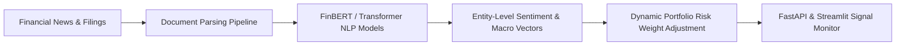

 

### 3. MandateGuard — Citi × NPCI DRUNIX Hackathon
*A cryptographic protocol proposal providing dual-signed, tamper-evident proof of recurring mandate revocation across UPI AutoPay participants.*
- **System Proposal:** Addresses chargeback and cancellation ambiguity in recurring digital payments. Specifies a bilateral cryptographic receipt architecture where remitter and beneficiary financial entities exchange signed revocation tokens, establishing an auditable settlement window to verify debit cessation.
- **Implementation Status:** Hackathon architectural proposal and design-stage proof of concept utilizing simulated participant nodes; not an integrated production banking deployment.
- **Tech Stack:** `Cryptographic Protocols` `Digital Signatures` `System Architecture Specification` `UPI Protocol Analysis`
- **Links:** [GitHub Repository](https://github.com/mridulrajgaria/mandateguard)

---

## 🛠️ Technical Arsenal

Organized by core engineering domain:

| Domain | Technologies & Frameworks |
| :--- | :--- |
| **Languages** | Java (17+ LTS), TypeScript, JavaScript (ES6+), Python (3.11+), SQL (PostgreSQL, MySQL, SQLite, T-SQL), HTML5, CSS3 |
| **Backend & Systems** | Node.js, Express.js, Spring Boot 3, RESTful API Design, Redis (Atomic Lua Scripting & Rate Limiting), JWT & RBAC, Prisma ORM, Spring Data JPA |
| **Frontend & UI** | React 18, Next.js, Redux Toolkit, Tailwind CSS, Vite, Recharts, Rough.js |
| **Databases & Storage** | PostgreSQL, MySQL, MongoDB, SQLite, H2 Database, Redis Cache |
| **Cloud & DevOps** | AWS (EC2, S3, Lambda, IAM), Microsoft Azure, Docker, Docker Compose, Render, Netlify, Vercel, GitHub Actions CI/CD |
| **Data Science & ML** | Pandas, NumPy, Scikit-learn, XGBoost, SHAP (Explainability), Dimensional Modeling (Star Schema), Power BI, Advanced SQL (CTEs, Window Functions) |
| **Applied AI & LLMs** | Prompt Engineering, Google Gemini API, Anthropic Claude API, NLP (Transformers, BERT, FinBERT), Vector Embeddings, Knowledge Graphs |
| **Developer Tools** | Git, Postman, Swagger / OpenAPI, Vitest, Linux / Bash, VS Code |

---

## 📜 Verified Certifications & Credentials

- ☁️ **AWS Certified Developer – Associate** — *Amazon Web Services*
- 📊 **Oracle Cloud Infrastructure 2025 Data Science Professional** — *Oracle*
- ⚡ **Microsoft Azure Data Fundamentals (DP-900)** — *Microsoft*
- 💼 **ServiceNow Virtual Internship Program** — *ServiceNow University, AICTE & SmartBridge*

---

## 📊 GitHub Contribution Activity

  
  &nbsp;
  
    
  

